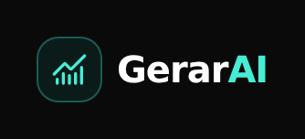
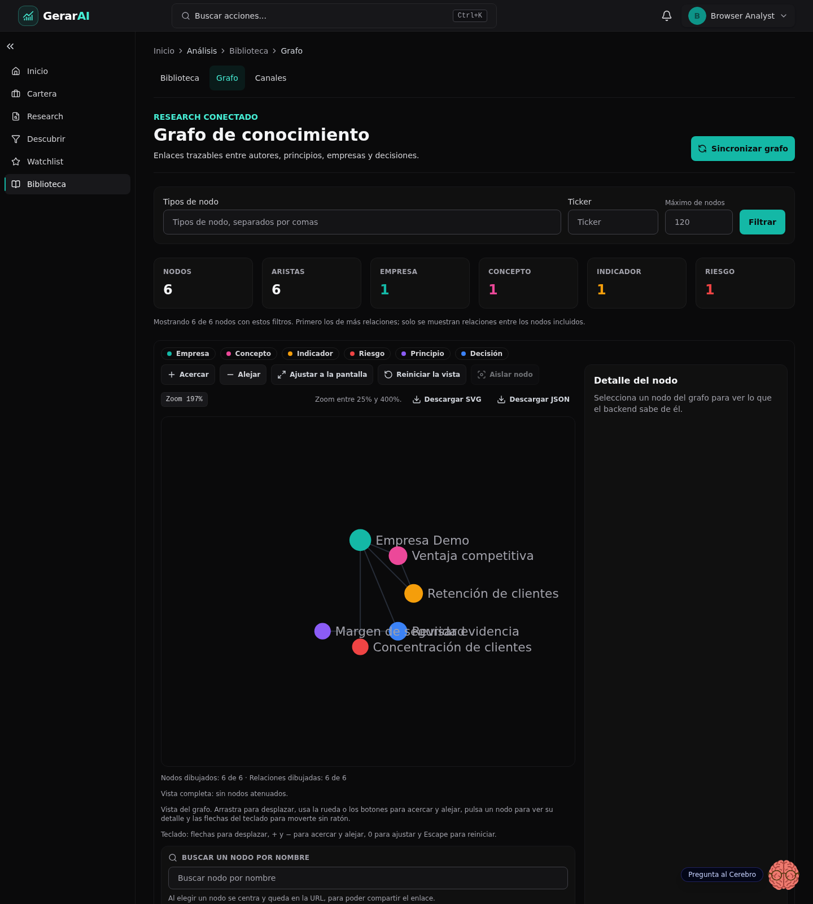
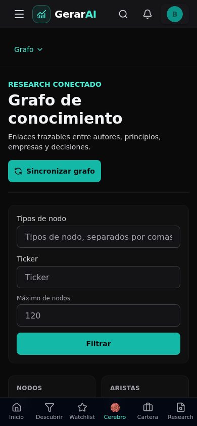
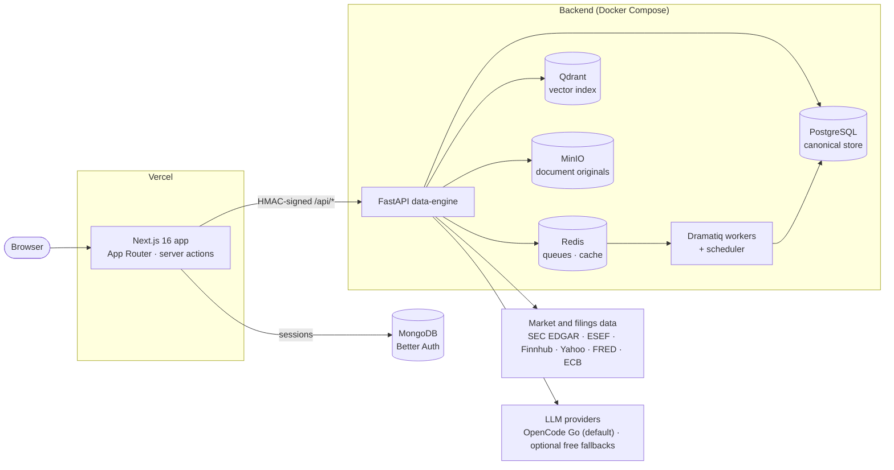

# GerarAI

<p></p>

**Investment research that keeps company evidence, valuation, versioned theses and portfolio decisions together.**

[](https://github.com/nicogarrr/GerarAI/actions/workflows/ci.yml)
[](https://github.com/nicogarrr/GerarAI/actions/workflows/coverage.yml)
[](https://github.com/nicogarrr/GerarAI/actions/workflows/codeql.yml)
[](https://github.com/nicogarrr/GerarAI/releases)
[](LICENSE)
[](https://gerarai.duckdns.org)
[](package.json)
[](data-engine/pyproject.toml)

> **Status:** v0.5.0 (pre-release), the production baseline of 30 October 2026. Hardening and review remain in progress.
> Live at [gerarai.duckdns.org](https://gerarai.duckdns.org) (access by request).
> The user interface is in Spanish (es-ES); code, APIs and this document are in English.
> **Not financial advice.** See the [disclaimer](#disclaimer).

## The research loop

1. Open a company workspace and inspect its data coverage and sources.
2. Run the available valuation and thesis workflow. Follow the backend job phases rather than an estimated completion percentage.
3. Review the thesis, its audit results and unresolved risks. Generation success is not publication.
4. Publish an eligible version through the manual approval flow, then check whether the knowledge-library sync succeeded.
5. Revisit the evidence alongside your watchlist, portfolio and decision journal.

**Scope:** Interactive Brokers Flex is an import and reconciliation path, not an order-entry interface. Paper trades are not live broker orders. Tax outputs are drafts, not submitted returns. Provider availability, completeness and cost depend on your configuration and service plans.

**Start here:** [Local setup](#quick-start) · [Architecture](docs/ARCHITECTURE.md) · [Release checklist](docs/RELEASE_READINESS.md) · [Security](SECURITY.md)

## App preview

Real GerarAI UI rendered locally from the current application code, with the existing E2E authentication bypass and a synthetic knowledge-graph fixture served by a minimal local test API. These are interface previews, not production data or an end-to-end backend validation. No personal account, portfolio, balances or real email addresses are shown.

### Desktop



### Mobile

Scrolled to the same synthetic graph, with the fixed header and bottom navigation visible.



The wordmark above is exported from the existing `GerarAIWordmark` header component with the app stylesheet, without redesigning it.

## Contents

- [The research loop](#the-research-loop)
- [App preview](#app-preview)
- [What it is](#what-it-is)
- [Key features](#key-features)
- [Architecture](#architecture)
- [Quick start](#quick-start)
- [Configuration](#configuration)
- [Data sources](#data-sources)
- [Testing and quality gates](#testing-and-quality-gates)
- [Deployment](#deployment)
- [Project structure](#project-structure)
- [Roadmap](#roadmap)
- [Contributing](#contributing) · [Security](#security) · [License](#license) · [Disclaimer](#disclaimer)

## What it is

GerarAI is a long-term investor's memory. It is not another market terminal or a DCF factory: it is where the reasons you own or follow each company live, together with the evidence that supports the thesis, the evidence that contradicts it, and how both change over time.

Three principles shape the codebase:

- **No invented data.** The product aims to keep source-backed figures distinct from inferred or unavailable data (`OFICIAL`, `INFERIDO`, `SIN_DATOS`). When a provider is missing or fails, the coverage is shown as unavailable instead of being filled in.
- **Deterministic numbers, generative prose.** Valuation, signals and tax figures are computed in code with a calculation trace. Deterministic calculations are kept separate from LLM-written prose, which still needs source and claim checks.
- **Cost-aware configuration.** Prefer free data and approved provider access. Free tiers, existing subscriptions and self-hosting are different cost models; no preset guarantees a zero bill.

The full product rationale is in [docs/PRODUCT_VISION.md](docs/PRODUCT_VISION.md).

## Key features

### Research and valuation

- **Company workspace** (`/research/[ticker]`): one coherent snapshot per company with financials, filings, news, ownership and insider activity.
- **Deterministic valuation engines**: DCF, SOTP, pre-revenue, banks, insurers, REITs, holding companies and commodity producers, each with a calculation trace.
- **Point-in-time guard**: historical multiples evaluated `as_of` a past date only use prices up to that date and SEC figures whose filing date precedes it, preventing look-ahead bias.
- **Insider signals**: SEC Form 4 purchases with cluster-buy detection.

### Theses

- **Versioned investment theses** with an audit trail, claims linked to supporting and contradicting evidence, and invalidation rules.
- **Devil's advocate debate**: an automated bull/bear debate whose verdict is persisted on the thesis.
- **Scenarios and projections** per thesis, plus EPUB export for e-readers.
- **Manual publication workflow** in the app, with audit-status checks and explicit risk confirmation when required. Telegram alerts do not imply a working thesis-approval interface.

### Cerebro (AI copilot)

- A chat assistant grounded in your portfolio, watchlist, filings and knowledge library, with **cited answers** that point back to their sources.
- Defaults to OpenCode Go (`deepseek-v4.1-flash`, reasoning effort `high`) with optional free-tier fallbacks. If every provider fails, it answers in a clearly labelled deterministic mode rather than generating text. Provider strategy: [docs/AI_PROVIDER_STRATEGY.md](docs/AI_PROVIDER_STRATEGY.md).

### Portfolio

- Positions and transactions with **XIRR** and portfolio intelligence (concentration, risk, stress scenarios).
- **Interactive Brokers** import via Flex Query, with reconciliation ([docs/PORTFOLIO_IBKR_RECONCILIATION.md](docs/PORTFOLIO_IBKR_RECONCILIATION.md)).
- Multi-currency positions with FX attribution.
- **Decision journal** with trade-linking workflows. Review ambiguous or incomplete matches rather than treating date proximity as proof of a trade association.
- **Paper trading** ([docs/paper-trading.md](docs/paper-trading.md)).

### DCA entry signals and alerts

- **Tiered DCA engine**: deterministic, look-ahead-free monthly levels from 1X to 4X of the base contribution, plus light and strong trim zones, for every watchlist and portfolio name.
- Per-ticker hit-rate history and **email alerts** when a level changes.
- **Rule-based alerts** on price, news and earnings, delivered by email or Telegram ([docs/telegram-outbound-alerts.md](docs/telegram-outbound-alerts.md)).

### Discovery

- **Screener** over stored fundamentals and quotes.
- **Watchlist** with DCA levels and quick evaluation.
- Earnings, dividend and macro calendars; market overview and themes.

### Tax (Spain)

- **Draft tax report** for the Spanish IRPF (capital gains and dividends) using official ECB exchange rates on each transaction date, and a **Modelo 720** draft. These are working drafts for review, not filings.

### Knowledge library (RAG)

- Upload PDF and Markdown documents, extract principles, approve them and query them with hybrid semantic search (Qdrant plus local embedding models; no paid embedding API).
- Optional Obsidian integration and a knowledge graph with search, selected-node context, keyboard controls and export. This is a graph of evidence and concepts, not a project-task scheduler.

## Architecture



- **Frontend** (repository root): Next.js 16, React 19, TypeScript, Tailwind CSS 4, Radix UI / shadcn, Recharts and Lightweight Charts. Authentication uses Better Auth with MongoDB.
- **Backend** (`data-engine/`): FastAPI, SQLAlchemy 2 and Alembic on Python 3.12, with Dramatiq workers and a scheduler on Redis.
- **Storage**: PostgreSQL is the source of truth; Qdrant is a semantic index; S3-compatible object storage holds original documents. The production Compose file also includes an optional Garage profile; changing the object store requires the documented migration, not just a diagram edit.
- **Trust boundary**: the frontend calls the research API with HMAC-signed requests (300-second window; the tenant is the authenticated user ID).

Details: [docs/ARCHITECTURE.md](docs/ARCHITECTURE.md).

## Quick start

### Prerequisites

- Docker with Docker Compose v2
- Node.js 22 and npm, for running the frontend outside Docker
- Python 3.12 and [uv](https://docs.astral.sh/uv/), for running the backend outside Docker

### Option A: full stack with Docker

```bash
git clone https://github.com/nicogarrr/GerarAI.git
cd GerarAI
cp docker.env.example .env        # then fill in the keys you need (see Configuration)
docker compose up --build
```

In a second terminal, apply migrations and load the public company taxonomy:

```bash
docker compose exec backend python -m alembic upgrade head
docker compose exec backend python -m app.seed
```

Open <http://localhost:3000>. The seed installs only the global company taxonomy; it never creates portfolios or user data.

| Service | Host port |
| --- | --- |
| Frontend (Next.js) | 3000 |
| Backend (FastAPI) | 8000 |
| MongoDB | 27017 |
| PostgreSQL | 5432 |
| Redis | 6379 |
| Qdrant | 6333 (6334 gRPC) |
| MinIO API / console | 9002 / 9003 |

All ports bind to `127.0.0.1` by default.

### Option B: run frontend and backend locally

Start only the infrastructure with Docker:

```bash
cp docker.env.example .env
docker compose up -d mongodb postgres redis qdrant minio
```

Backend. It reads `.env` from its working directory, so create `data-engine/.env` with the backend variables:

```bash
cd data-engine
uv sync --frozen --extra test --extra dev --no-install-project
source .venv/bin/activate
python -m alembic upgrade head
python -m app.seed
python -m uvicorn main:app --host 127.0.0.1 --port 8000
```

Frontend, from the repository root in another terminal:

```bash
npm ci
npm run dev
```

### Other options

- **GitHub Codespaces**: the repository ships a `.devcontainer/` that starts the full stack (Node 22, Python 3).
- **Windows**: `arrancar_gerarai.bat` starts the infrastructure in Docker, applies migrations and runs both servers locally.

## Configuration

All configuration is provided through environment variables. Templates:

- [`docker.env.example`](docker.env.example): local development and Docker Compose.
- [`.env.production.example`](.env.production.example): production backend.

Never commit a real `.env`; only the `.example` files are versioned. Generate secrets with `openssl rand -base64 32`.

### Frontend variables (Next.js / Vercel)

| Variable | Purpose | Required |
| --- | --- | --- |
| `MONGODB_URI` | MongoDB connection used by Better Auth | Yes |
| `BETTER_AUTH_SECRET` | Session signing secret (32+ characters) | Yes |
| `BETTER_AUTH_URL` | Public base URL of the app | Yes |
| `RESEARCH_AUTH_SECRET` | HMAC secret shared with the backend (32+ characters) | Yes |
| `FMP_BACKEND_URL` | Base URL of the FastAPI data-engine (historical name) | Yes |
| `NEXT_PUBLIC_SITE_URL` | Canonical site URL for metadata and links | Optional |
| `ALLOW_PUBLIC_SIGNUP`, `SIGNUP_ALLOWLIST`, `REQUIRE_EMAIL_VERIFICATION` | Sign-up policy (closed by default in production) | Optional |
| `FINNHUB_API_KEY` | Quotes, profiles and news | Optional |
| `SMTP_USER`, `SMTP_PASS`, `ACCESS_REQUEST_NOTIFY_EMAIL` | Access-request notification email | Optional |

### Backend variables (`data-engine`)

| Variable | Purpose | Required |
| --- | --- | --- |
| `APP_ENV` | `local`, `test` or `production`; production enables strict validation | Yes |
| `DATABASE_URL` | PostgreSQL connection (SQLite is rejected in production) | Production |
| `RESEARCH_AUTH_SECRET` | HMAC secret shared with the frontend | Production |
| `CORS_ORIGINS` | Allowed origins (`*` is rejected) | Production |
| `MINIO_ENDPOINT`, `MINIO_ACCESS_KEY`, `MINIO_SECRET_KEY`, `MINIO_BUCKET` | Object storage for document originals | Production |
| `REDIS_URL` | Job queues and cache | Production |
| `WORKERS_ENABLED` | Enables background workers | Optional |
| `SEC_USER_AGENT` | Contact string sent to SEC EDGAR, as SEC's fair-access policy requires | Recommended |
| `QDRANT_URL`, `VECTOR_STORE`, `CAVAAI_ENABLE_VECTOR_INGEST`, `CAVAAI_ENABLE_VECTOR_SEARCH`, `CAVAAI_ENABLE_VECTOR_CHAT` | Vector RAG | Optional |
| `LLM_ENABLED`, `LLM_PROVIDER` | Enable and select the LLM provider (`disabled` turns it off) | Optional |
| `OPENCODE_GO_API_KEY`, `OPENCODE_GO_MODEL`, `OPENCODE_GO_REASONING_EFFORT` | Default LLM provider | Optional |
| `FINNHUB_API_KEY`, `FMP_API_KEY`, `FRED_API_KEY`, `NEWSAPI_KEY`, `MARKETAUX_API_KEY`, `ALPHA_VANTAGE_API_KEY` | Optional data providers | Optional |
| `IBKR_FLEX_TOKEN`, `IBKR_FLEX_QUERY_ID` | Interactive Brokers Flex import | Optional |
| `TELEGRAM_ENABLED`, `TELEGRAM_BOT_TOKEN`, `TELEGRAM_CHAT_ID`, `TELEGRAM_LINK_SECRET` | Telegram alerts | Optional |
| `SMTP_HOST`, `SMTP_PORT`, `SMTP_USERNAME`, `SMTP_PASSWORD`, `SMTP_FROM`, `SMTP_STARTTLS`, `SMTP_SSL` | Outbound email for alerts, including DCA signals | Optional |

The complete list, including LLM fallbacks, observability and data-retention settings, is in the example files. LLM-specific variables are documented in [docs/AI_PROVIDER_STRATEGY.md](docs/AI_PROVIDER_STRATEGY.md).

## Data sources

The source integrations below have different access conditions and limits. Verify the current operator terms and your plan before enabling a provider; this table is not a pricing guarantee.

| Source | Used for | Access | Licensing notes |
| --- | --- | --- | --- |
| SEC EDGAR | XBRL company facts, 10-K/10-Q/20-F/40-F filings, Form 4 | Free, no key | US public data. Fair-access policy: identify yourself with `SEC_USER_AGENT` and respect rate limits. |
| ESEF via filings.xbrl.org | Structured financials for European issuers (local snapshot covers IBEX constituents) | Free, no key | Filings remain the issuers' documents; review filings.xbrl.org's terms. |
| Yahoo Finance | Index levels, quote fallback, complementary fundamentals | Free, no key | **Unofficial** endpoints with no SLA; may change or break. Data is labelled «no oficial» in the app. For personal use only. |
| Stooq | Historical prices | Free, no key | Personal use; no SLA. |
| Finnhub | Quotes, profiles, news, calendars | Free tier, key | Subject to Finnhub's free-tier terms and rate limits. |
| Financial Modeling Prep | Profiles, dividends, splits, cross-checks of SEC figures | Optional free tier, key | Disabled unless `FMP_API_KEY` is set. |
| FRED | Macro series (CPI, unemployment, rates) | Free key | FRED terms of use; some series carry third-party copyright. |
| ECB | Official euro reference exchange rates (FX and tax report) | Free, no key | ECB statistical data, free reuse with attribution. |
| Damodaran Online | Equity risk premium and WACC inputs | Free | Public academic datasets. |
| Nasdaq calendar | Earnings and dividend dates | Free, no key | Unofficial public endpoint. |

LLM-written text can still contain incorrect claims. Use the stored evidence, audit results and deterministic calculation traces when reviewing an analysis.

## Testing and quality gates

Commands below describe checks to run, not a current pass count. Local unit tests, browser tests, deployed smoke tests and provider checks cover different boundaries. A green subset does not certify the full app.

The same gates run locally and in CI ([AGENTS.md](AGENTS.md), [docs/QUALITY_GATES.md](docs/QUALITY_GATES.md)).

Backend, from `data-engine/`:

```bash
uv sync --frozen --extra test --extra dev --no-install-project
ruff check .
pyright                                   # 0 errors required
APP_ENV=test pytest -q -p no:warnings
python scripts/run_valuation_evals.py     # also run_llm_evals.py, run_ingest_evals.py, run_rag_evals.py
```

Frontend, from the repository root:

```bash
npm run lint
npm run typecheck
npm run test:unit                         # Vitest + Testing Library
npm run test:e2e                          # Playwright (starts the servers it needs)
npm run test:e2e:flows                   # Browser user flows (docs: docs/FRONTEND_TESTS.md)
```

The OpenAPI client must not drift from the backend:

```bash
npm run generate:openapi
git diff --exit-code -- data-engine/openapi.json lib/research/openapi.generated.ts
```

CI ([`.github/workflows/ci.yml`](.github/workflows/ci.yml)) also checks dependency parity, auth-store smoke tests, evals for RAG, valuation, LLM layers and ingestion, Postgres migration round trips with a single Alembic head, supply-chain audits, and API and browser end-to-end tests, all behind one required `CI gate` check. Coverage, CodeQL, Gitleaks and SBOM scanning run as separate workflows. Coverage details: [docs/COVERAGE.md](docs/COVERAGE.md).

## Deployment

The repository includes the following deployment topology. It is not a statement that a particular installation is configured or healthy:

- **Frontend on Vercel** ([`vercel.json`](vercel.json)): Next.js build in the `fra1` region. Only `main` deploys automatically. Recovery runbook: [docs/RUNBOOK_VERCEL_DEPLOY_RECOVERY.md](docs/RUNBOOK_VERCEL_DEPLOY_RECOVERY.md).
- **Backend on Oracle Cloud** (Always Free, Ampere ARM VM) with [`docker-compose.prod.yml`](docker-compose.prod.yml): Caddy, PostgreSQL, Redis, Qdrant, MinIO, API, worker and scheduler, with health checks and automatic restarts. Setup: [docs/oracle-setup.md](docs/oracle-setup.md).

Operational notes:

- Migrations are always explicit (`alembic upgrade head`).
- Database ports are never exposed publicly; secrets live only in the deployment environment.
- Backups and the restore drill: [docs/BACKUP_RESTORE.md](docs/BACKUP_RESTORE.md). Key rotation: [docs/ROTACION_CLAVES.md](docs/ROTACION_CLAVES.md).
- `render.yaml` is experimental and unsupported: it requires external Postgres, Redis, Qdrant and MinIO.

## Project structure

```text
.
├── app/            Next.js App Router pages and API routes
├── components/     UI components
├── lib/            Server actions, signed research API client, shared logic
├── hooks/          React hooks
├── types/          Shared TypeScript types
├── data-engine/    FastAPI backend: routes, services, valuation, workers, Alembic, tests, evals
├── e2e/            Playwright end-to-end specs
├── qa-e2e/         Read-only QA end-to-end suite
├── tests/          Frontend unit tests
├── scripts/        Guards, diagnostics and tooling
├── docs/           Architecture, runbooks, policies and ADRs
├── docker/, infra/ Container and infrastructure configuration
└── public/         Static assets
```

## Roadmap

- **Deployment readiness, not a completion claim**: green CI, a single Alembic head, end-to-end smoke tests and per-deployment environment checklists ([docs/RELEASE_READINESS.md](docs/RELEASE_READINESS.md)).
- Broader non-US coverage (ESEF and IFRS filers).
- Better retrieval quality for Cerebro on the knowledge library and filings.

See [CHANGELOG.md](CHANGELOG.md) for released changes.

## Contributing

Contributions follow [CONTRIBUTING.md](CONTRIBUTING.md): small, single-topic pull requests, green CI and no secrets in commits. Automated agents should also read [AGENTS.md](AGENTS.md).

## Security

Please do not open public issues for vulnerabilities. Report them privately as described in [SECURITY.md](SECURITY.md).

## License

Copyright © 2025 Nicolás Iglesias García. Licensed under the [GNU Affero General Public License v3.0](LICENSE). If you run a modified version as a network service, the AGPL requires you to make its source available to its users.

A historical Spanish README is kept in [docs/README.es.md](docs/README.es.md); it is not the current setup or capability reference.

## Disclaimer

GerarAI is a personal research tool. Nothing it shows is financial, investment, legal or tax advice. Market data may be delayed, incomplete or wrong depending on the provider, and AI-generated text can contain mistakes. Tax reports are drafts that must be reviewed before filing. Do your own research and consult a qualified professional before making decisions.
