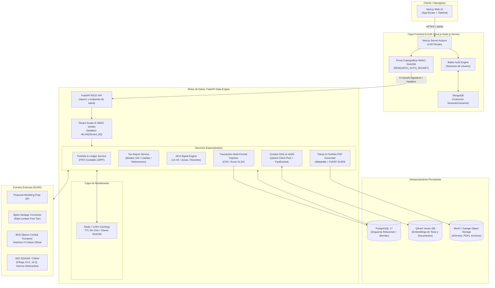
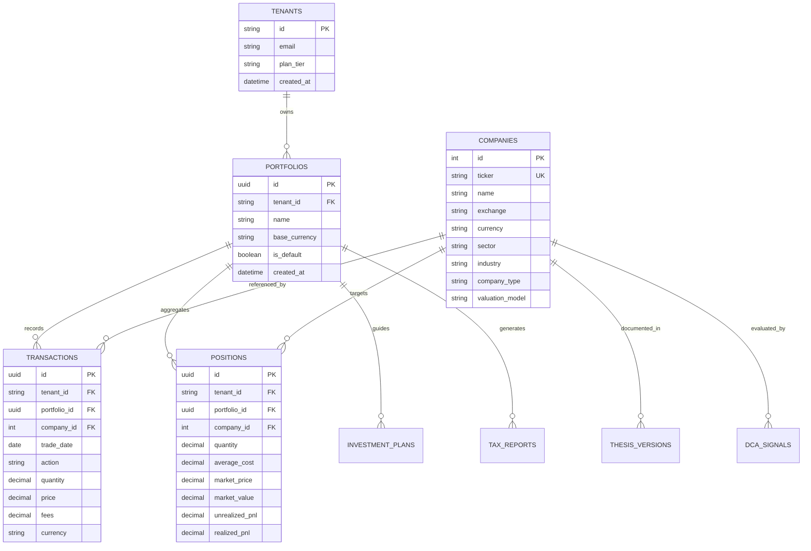

# Arquitectura del Sistema GerarAI

Fulfills: VAL-DOC-001 (document-architecture)

GerarAI es una plataforma integral de análisis fundamental, gestión de carteras y ejecución sistemática DCA, orientada a inversores particulares e institucionales. Cumple con estrictas premisas de seguridad multitenant, rendimiento en tiempo real y coste cero de infraestructura en modelos LLM (EUR0).

---

## 1. Diagrama de Componentes y Flujo de Datos

---

## 2. Aislamiento Multitenant y Seguridad Criptográfica

1. **Identidad Unificada**: Cada usuario autenticado en Next.js posee un `user.id`. El servidor Next.js firma las peticiones hacia el backend FastAPI mediante HMAC-SHA256 utilizando la clave simétrica `RESEARCH_AUTH_SECRET` con ventana temporal de validez (300 segundos para prevenir replay attacks).
2. **Contexto de Sesión en Base de Datos**: FastAPI valida la firma en `app/core/auth.py`. Al validarse, se inyecta el `tenant_id` en `db.info["tenant_id"]`.
3. **Filtros Estrictos de Aislamiento**: Cada consulta y mutación sobre entidades sensibles (`Portfolio`, `Transaction`, `Position`, `InvestmentPlan`, `TaxReport`) aplica obligatoriamente los predicados `*tenant_filters(db, Entity)` impidiendo cualquier fuga cross-tenant.

---

## 3. Esquema Relacional de Base de Datos (PostgreSQL)

---

## 4. Puntos de Integración del API

| Módulo | Endpoint Principal | Propósito | Autenticación |
|---|---|---|---|
| **Salud** | `GET /api/health` | Estado del motor, Postgres, Scheduler y versión | Pública |
| **Fuentes de Datos** | `GET /api/health/data-sources` | Circuit breaker y latencia de APIs externas | Requiere HMAC |
| **Cartera** | `GET /api/portfolio/summary` | Resumen contable, valor de mercado y rentabilidad | Requiere HMAC (Tenant) |
| **Transacciones** | `POST /api/portfolio/transactions` | Registro y replay contable FIFO de transacciones | Requiere HMAC (Tenant) |
| **Importación** | `POST /api/portfolio/import/preview` | Validación y parseo multiformato (CSV/Excel) | Requiere HMAC (Tenant) |
| **Exportación PDF** | `GET /api/portfolio/{portfolio_id}/pdf` | Generación de informe PDF institucional | Requiere HMAC (Tenant) |
| **Fiscalidad** | `GET /api/taxes/report/{fiscal_year}` | Cálculo de casillas Modelo 100 y compensación IRPF | Requiere HMAC (Tenant) |
| **DCA Engine** | `GET /api/watchlist/dca-signals` | Niveles 1X-4X, zonas de compra y recortes de la watchlist | Requiere HMAC |
| **Cerebro RAG** | `POST /api/chat` | Búsqueda semántica híbrida con pool Qdrant | Requiere HMAC |
| **Caché** | `GET /api/cache/stats` | Métricas de acierto/fallo y latencia de Redis | Requiere HMAC |

---

## 5. Estrategia de Rendimiento y Escalabilidad

- **Pool de Conexiones**: SQLAlchemy gestiona un pool con reciclaje automático (`pool_pre_ping=True`, tamaño 10, overflow 20).
- **Qdrant Client Pool**: Los clientes Qdrant se reutilizan de forma thread-safe evitando desconexiones y re-aperturas de sockets gRPC/HTTP.
- **Redis Multi-Layer Caching**: Claves deterministas SHA256 para cotizaciones (TTL 5 min), valoraciones de cartera (TTL 10 min) y señales DCA (TTL 5 min), con invalidación reactiva mediante eventos SQLAlchemy.
- **Generación PDF Zero-Cost**: Procesamiento asíncrono y en memoria de PDFs mediante matplotlib y pypdf, sin dependencias externas pesadas como Chromium/Puppeteer.
